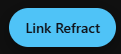
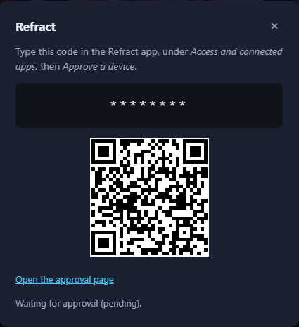
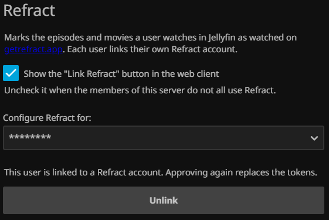

# Refract for Jellyfin

[](https://github.com/vasilvestre/jellyfin-plugin-refract/actions/workflows/build.yaml)
[](https://github.com/vasilvestre/jellyfin-plugin-refract/actions/workflows/test.yaml)
[](https://jellyfin.org)

Records the episodes and movies you watch in Jellyfin on [Refract](https://getrefract.app),
a cross-media tracker for shows, movies and anime on iOS and Android.

A Jellyfin plugin, installed from the catalogue, that marks a play as watched for each
user who linked their own Refract account: episodes with the right season and episode
number, movies with their play date, anime with the right numbering order.

Jellyfin sets the played flag; the plugin sends it to Refract with the date Jellyfin
stored. Clearing the flag in Jellyfin does not clear the watch on Refract: the API
removes a movie play by its own play id, and the plugin keeps no copy of it.

## Requirements

- Outbound HTTPS to `https://getrefract.app` from the Jellyfin server. Nothing else, no proxy.
- Jellyfin 12.1 or newer.
- A Refract account. Refract opens its API to a first group of members only: a
  member outside it cannot approve the app.

No key to create and no secret. Each user links their own account once, from the web client.

## Install

From the catalogue:

1. Open **Dashboard**, **Plugins**, **Repositories**.
2. Add `https://raw.githubusercontent.com/vasilvestre/jellyfin-plugin-refract/main/manifest.json`.
3. Open the **Catalogue**, find **Refract**, install it, and restart Jellyfin.

By hand:

1. Download `jellyfin-plugin-refract_<version>.zip` from the releases page.
2. Unzip it into `plugins/Refract_<version>/` in the Jellyfin data directory.
3. Restart Jellyfin.

Then link each account. Refract records the same plays either way; only the way a
member links their account changes.

## Linking an account

[File Transformation](https://github.com/IAmParadox27/jellyfin-plugin-file-transformation)
controls how much a member can do without an administrator.

| | Without File Transformation | With File Transformation |
|---|---|---|
| Who starts the link | An administrator, for any user | Each member, for their own account |
| Where | **Dashboard**, **Plugins**, **Refract** | A **Link Refract** button inside the web client |
| Extra request in the client | None | One script tag in `index.html`, served from memory |
| Scrobbling, title matching, movie plays | Identical | Identical |

Without it, an administrator opens **Dashboard**, **Plugins**, **Refract**, picks the
user, clicks **Sign in to Refract**, then gives the eight-character code to that
member, who approves it in the Refract app. Jellyfin 12 shows plugin pages to
administrators only, which is why a member cannot reach that page.

With it, the member does everything from the player:

1. Click **Link Refract** in the bottom right corner. The button appears only for a
   member who has not linked yet, and never on the plugin page, which has its own
   controls.

   

2. Scan the QR code with a phone, or open the link shown. The code is already in
   the address, so **Approve a device** only asks for a confirmation.

   

3. The modal confirms on its own within a few seconds.

An administrator can turn the button off for the whole server from the plugin page,
for example when most members do not use Refract:



The button only exists when File Transformation is installed: the plugin registers an
`index.html` transformation through its documented reflection interface, and injects
nothing when the plugin is absent. No file on disk changes.

After a plugin upgrade, reload the page without the cache (Ctrl+Shift+R on Firefox and
Chrome). The widget URL carries the plugin version, so the browser picks up the new one.


## Watchlist sync

The plugin can keep each member's Refract watchlist and their Jellyfin watchlist
identical, in both directions, removals included.

Jellyfin has no watchlist of its own. This sync uses the **Likes** field, which is
what the [KefinTweaks](https://github.com/ranaldsgift/kefintweaks) watchlist button
writes: it calls `updateUserItemRating`, so the button state and the sync agree.

Jellyfin 12 keeps no separate Likes column. A like is stored as a 10 rating and an
unlike as a 1 rating, so the sync moves ratings with it. Do not use this feature on
a server where members rate titles for their own sake. Two conditions must hold:

1. KefinTweaks is installed through the JavaScript Injector plugin, with its
   `watchlist` feature on. The plugin reads that setting before it writes anything.
2. An administrator ticks **Sync the watchlist with Refract** on the plugin page.

The scheduled task `Sync the Refract watchlist` then runs every 15 minutes. You can
run it by hand from Dashboard, Scheduled Tasks.

- The sync covers movies and shows. Refract has no watchlist for seasons or
  episodes, so those stay in Jellyfin only.
- A title missing from one side is read as a removal, because the plugin stores the
  pairs it left on both sides. Without that record a removal and a title the other
  side never had would look the same.
- Refract leaves a title alone when it sits in the library with another status
  (in progress, completed). The plugin records such a title and never removes it.
- Turn the sync off before a member rates titles they do not plan to watch.
  Otherwise every title rated 6.5 or more lands on the Refract watchlist.

## Requesting missing titles through Seerr

A title on a member's Refract watchlist that is not in the library cannot sync
either way. The watchlist tab shows these titles in a "To download via Seerr"
section, each with a **Request** button, so the member can ask for them.

The card and the request come from Jellyfin Enhanced's Seerr integration, reused
directly: this plugin holds no Seerr key. Three things must hold:

1. The member linked their Refract account.
2. KefinTweaks is installed, so the watchlist tab exists.
3. Jellyfin Enhanced is installed with Seerr configured, so the poster and the
   request have somewhere to go.

Without Jellyfin Enhanced the section does not appear.

## How a title is matched

Jellyfin keeps no TMDB id on episodes, so the plugin resolves them in two steps:

1. It reads the TMDB id of the series, falling back to TheTVDB then IMDb.
2. It asks Refract to translate the season and episode numbers from the series'
   numbering to TMDB numbering.

Anime is where those orders differ. The plugin tries `tmdb`, then `tvdb`, then
`absolute`, and remembers the first combination that matched the series. Enable
debug logging on the plugin to see each attempt.

## Sign-in

The plugin signs in with the OAuth 2.1 device code grant, RFC 8628. A Jellyfin
plugin runs on the server and has no browser, so the member approves a short code
on their phone at `getrefract.app/device`. The client is public: it holds no
secret, and the tokens belong to the member, who can revoke them from the Refract
app at any time.

The access token lasts one hour. The plugin refreshes it before it expires and
stores the rotated refresh token before using it. A refused refresh means the
member disconnected the app: the plugin drops the link and stops syncing.

## Known limits

- **No partial progress.** Refract stores watched or not watched. The resume
  position does not travel.
- **No rewatch from Jellyfin.** The plugin marks an episode watched. Refract keeps
  the first watch date.
- **One Refract account per Jellyfin user.** Each link stores its own tokens.
- **No sync from Refract to Jellyfin yet.** The change feed makes it possible.

## Build

```bash
docker run --rm -v "$PWD":/src -w /src mcr.microsoft.com/dotnet/sdk:10.0 \
  dotnet build Jellyfin.Plugin.Refract -c Release
```

The DLL is `Jellyfin.Plugin.Refract/bin/Release/net10.0/Jellyfin.Plugin.Refract.dll`.
Ship that file alone: the server already provides the Jellyfin assemblies.

## Credits

The icon in `img/logo.png` is the Refract app icon, used to identify the service the
plugin talks to. Refract owns it; this project claims no rights over the mark.

## Licence

GPL-3.0, the licence the Jellyfin plugin ecosystem uses.

## Releasing

The release workflow does the packaging, the GitHub release and the manifest edit,
so a tag is the only thing to push:

```bash
# Set <Version> in Directory.Build.props first, then:
git tag -a v1.0.14.0 -m "What changed, in one sentence"
git push origin v1.0.14.0
```

The tag must match `<Version>` exactly; the workflow fails otherwise, on purpose.
Do not create the release on GitHub by hand: the workflow does it, and an existing
release makes `gh release create` fail.
